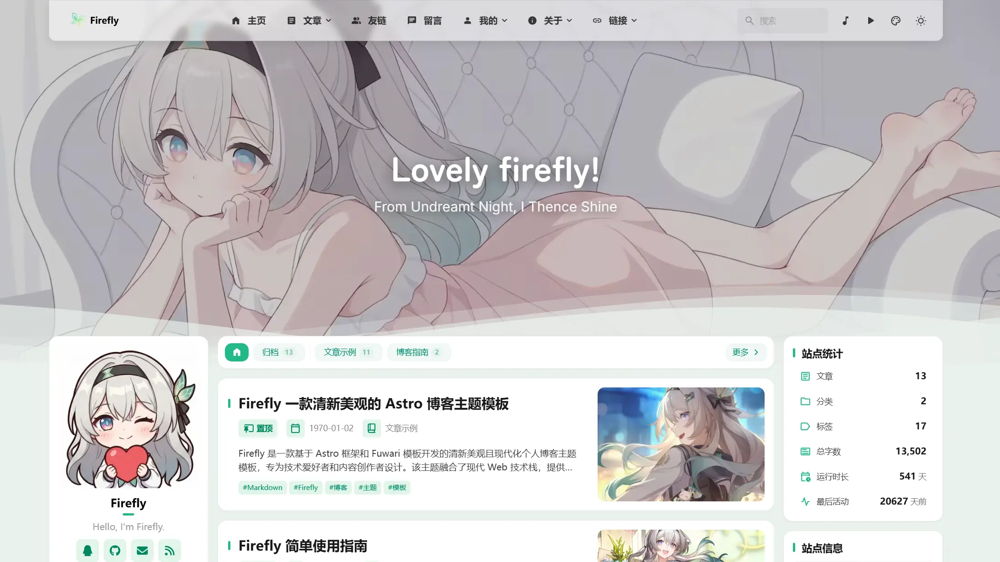
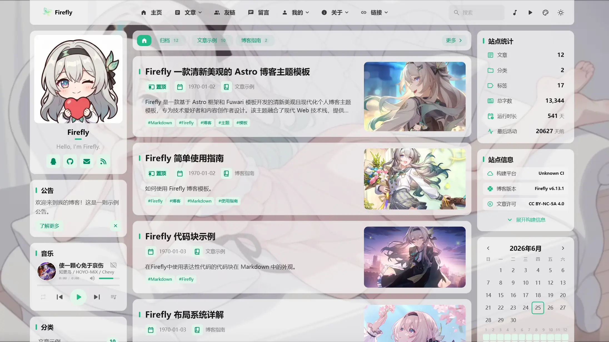
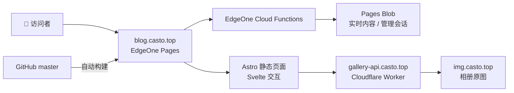

<div align="center">


# ✨ 星遐蝶梦

### 在代码、星光与生活的缝隙里，收藏每一次心动。

欢迎来到 **Casto 的个人小站**。这里有折腾程序和网站的笔记，有微电子学习和开源实践，也有动画、游戏、摄影和不经意间想留下来的日常。

**[🌸 进入小站](https://blog.casto.top/)** · **[📷 逛逛相册](https://blog.casto.top/gallery/)** · **[✍️ 读读文章](https://blog.casto.top/archive/)** · **[💭 看看动态](https://blog.casto.top/dynamic/)**

[](https://astro.build/)
[](https://svelte.dev/)
[](https://www.typescriptlang.org/)
[](https://pnpm.io/)
[](https://edgeone.ai/)
[](LICENSE)

</div>

---

## 🌷 嘿，你好！

这里不只是一个博客，也是一间可以随时翻开的小小收藏室。

有时候在文章里认真讨论技术、分享实践过程；有时候在动态里记下当天的碎碎念；更多时候，会为好看的风景、喜欢的角色或一个精巧的界面驻足许久。希望你来的时候，能够发现一些实用的东西，也能够收获一点轻松与好心情。

<table>
  <tr>
    <td width="50%" align="center">
      
      <sub>宽阔通透的页面 · Firefly 主题设计示意</sub>
    </td>
    <td width="50%" align="center">
      
      <sub>轻盈灵动的页面 · Firefly 主题设计示意</sub>
    </td>
  </tr>
</table>

> 上面的图片展示 Firefly 主题的设计风格；**本站的实时内容、配色与个性化布局请以 [blog.casto.top](https://blog.casto.top/) 为准。**

## 🗺️ 小站漫游指南

| 想做什么？ | 入口 | 你会遇见 |
| --- | --- | --- |
| 📚 看技术与随笔 | [文章归档](https://blog.casto.top/archive/) | 编程、部署、学习笔记和生活记录 |
| 🖼️ 收藏喜欢的画面 | [摄影与图集](https://blog.casto.top/gallery/) | 独立管理的公开相册、照片与插画 |
| 💬 看最近在想什么 | [日常动态](https://blog.casto.top/dynamic/) | 比长文章更随意的瞬间 |
| 🗂️ 找实用网站 | [书签导航](https://blog.casto.top/booknav/) | 常用工具、资源与发现 |
| 🏷️ 按兴趣翻阅 | [文章标签](https://blog.casto.top/tags/) | 在不同话题之间自由探索 |
| 🤝 认识有趣的人 | [友情链接](https://blog.casto.top/friends/) | 通往其他小世界的门 |
| 🌟 多了解一点我 | [关于我](https://blog.casto.top/about/) | 关于站长和这座小站的故事 |

## 📸 一点点喜欢的画面

相册有属于自己的公开图片 API 和图床。打开一张喜欢的照片时，原始图片不会因为网站的缩略图加速而被修改；你也可以根据自己的网络环境选择 **智能加速 / Cloudflare 缓存 / 原图直连** 三种访问线路。

<table>
  <tr>
    <td width="50%" align="center">
      <a href="https://blog.casto.top/gallery/castorice-2026/"></a>
      <sub>✨ 遐蝶图集 · 本站公开相册实景</sub>
    </td>
    <td width="50%" align="center">
      <a href="https://blog.casto.top/gallery/wei-wei-an/"></a>
      <sub>🌸 薇薇安 · 本站公开相册实景</sub>
    </td>
  </tr>
</table>

> [去相册继续看看 →](https://blog.casto.top/gallery/)

## 💫 这个小站有什么特别的？

- **为阅读而设计**：Astro 生成内容页面，兼顾响应速度、SEO、文章目录与全文检索。
- **轻盈又有个性**：自适应明暗模式、背景壁纸、主题色、音乐播放器和细腻的卡片交互。
- **日常也值得记录**：文章、动态、标签、分类、系列、友链与书签导航并存。
- **独立的图片世界**：相册通过专属 API 管理元数据和图片资源；网格缩略图、缓存线路和原图直连互不破坏。
- **自己的内容后台**：主站导航栏右上角的管理图标通往 [内容后台](https://blog.casto.top/admin/)，供授权管理员维护文章、动态与站点配置；普通访客可安心浏览。
- **认真对待数据**：公开内容与管理员接口分离，敏感操作要求 GitHub 管理员身份及后端会话，定期归档实时内容。

## 🛠️ 建造这片小天地的技术

| 部分 | 技术与用途 |
| --- | --- |
| 页面与构建 | **Astro 7**、TypeScript、Tailwind CSS |
| 交互组件 | **Svelte 5** |
| 内容组织 | Markdown / MDX、Astro Content Collections、Pagefind 搜索 |
| 正式网站 | **腾讯云 EdgeOne Pages**，GitHub `master` 自动触发构建 |
| 实时内容与管理会话 | EdgeOne Cloud Functions + Pages Blob |
| 公开相册 API | Cloudflare Worker `firefly-gallery-api` |
| 图片与图床 | `img.casto.top`；缓存与缩略图独立于原图 |
| 开发验证 | GitHub Actions 检查、单元测试、Astro 类型检查 |



正式部署由 **EdgeOne Pages 与 GitHub 仓库集成**完成。本仓库里的预览环境、Cloudflare Worker 和其他开发工具均不是正式博客的替代部署目标。

## 🚀 在本地跑起来

准备 Node.js **22.23+** 和 **pnpm 11.22.0**，然后：

```bash
git clone https://github.com/SteveGuo1726/Firefly.git
cd Firefly
corepack enable
pnpm install --frozen-lockfile
pnpm dev
```

浏览器打开 Astro 在终端提示的本地地址即可。正式构建与检查：

```bash
pnpm astro check
pnpm test:live-content
pnpm build
```

> 构建脚本还会生成封面缩略图、好友圈与搜索索引等衍生数据。外部公共 API 不可达时，部分生成器具有回退逻辑；正式功能和最新内容以生产环境为准。

项目常看的地方：

```text
src/pages/           页面与路由
src/components/      Astro / Svelte UI 组件
src/content/         Markdown / MDX 内容
src/config/          站点、导航、壁纸等配置
src/server/          实时内容和管理权限逻辑
cloud-functions/     EdgeOne 服务端接口
worker/              独立相册 API 与博客预览 Worker
public/              静态资源、图标和图片
tests/               回归测试
docs/                配置说明与进阶文档
```

### 生产后台与发布

正式管理员入口为 [**/admin/**](https://blog.casto.top/admin/)。只有授权 GitHub 账号才能执行管理操作。管理登录使用安全会话；若使用 GitHub Fine-grained PAT，请仅在网站登录框内填写，**不要提交到仓库、Issue 或聊天记录**。

- EdgeOne 正式项目的构建、环境变量与回调配置，请参阅 [生产后台接入说明](docs/edgeone-admin-production.md)。
- 相册与图床是独立服务，其管理密钥只在服务端配置，**不会**存放在 README、前端代码或仓库内。
- `blog.casto.top` 为正式网站；`gallery-api.casto.top` 和 `img.casto.top` 分别提供图库 API 与图片资源。不要擅自把正式部署改成 Vercel 或其他预览项目。

## 🤍 致谢与约定

这座小站基于开源项目 **[CuteLeaf / Firefly](https://github.com/CuteLeaf/Firefly)** 开始搭建，并持续加入属于自己的内容、设计与网站功能。感谢原作者、Astro / Svelte 生态，以及每一位分享代码和灵感的朋友。

- **主题基础**：[Firefly](https://github.com/CuteLeaf/Firefly)
- **当前个性化版本**：[SteveGuo1726 / Firefly](https://github.com/SteveGuo1726/Firefly)
- **授权协议**：[MIT License](LICENSE)
- **文章、摄影、个人内容**：请尊重各内容页面标注的著作权与转载要求；仓库开源不意味着个人作品自动进入公共领域。

如果你也喜欢创造、折腾、阅读或者收藏美好的画面，欢迎常来坐坐。🌠

<div align="center">

### 愿你每次来访，都能遇见一点新鲜的星光。

**[🏠 返回首页](https://blog.casto.top/)** · **[📷 打开相册](https://blog.casto.top/gallery/)** · **[✉️ 留言交流](https://blog.casto.top/guestbook/)**

<sub>Made with care · 星遐蝶梦 / Firefly</sub>

</div>
